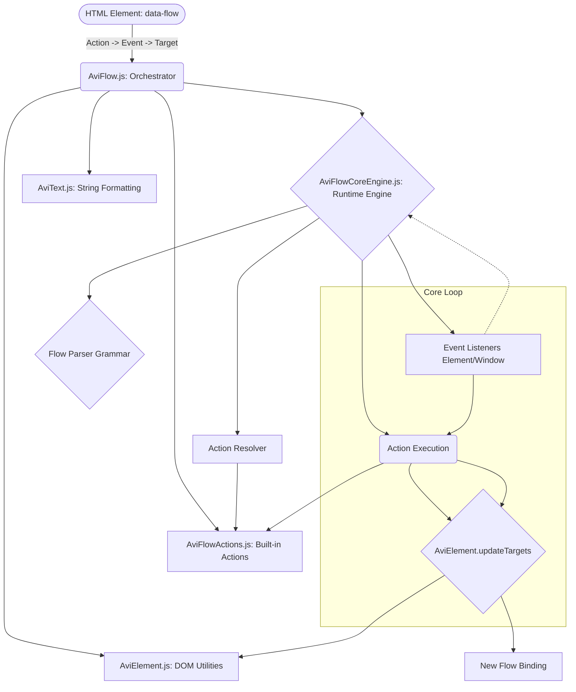

# AviFlow Framework Architecture

## Overview
AviFlow is a declarative data flow mechanism for web development that interprets a `data-flow` attribute on HTML elements. It allows developers to define sequences of operations (events, actions, and targets) directly in HTML, abstracting complex DOM event handling and data synchronization logic into a single, readable syntax.

The framework follows a modular, decoupled architecture, relying on a central orchestrator (`AviFlow`) that delegates runtime responsibilities to a core engine (`AviFlowCoreEngine`) and utilizes specialized utility classes for DOM interaction (`AviElement`, `AviFlowActions`).

## 🏛️ Component Diagram



## 🧩 Component Breakdown

### 1. The Orchestrator: `AviFlow.js`
`AviFlow` serves as the public entry point and primary interface.
*   **Responsibility:** Initializing the framework, accepting custom actions/options via the constructor, and triggering the initialization process (`init()`).
*   **Functionality:** It manages the mapping between action strings (e.g., `"fetch"`) and their actual implemented functions. It provides the `resolveAction(path)` method, which implements a robust lookup mechanism for dotted action paths (e.g., `"admin.users.remove"`).

### 2. The Runtime: `AviFlowCoreEngine.js`
This is the engine responsible for managing the lifecycle of a flow definition.
*   **Responsibility:** Parsing, binding, and executing flows.
*   **Parsing:** Uses `parseFlow()` to break down the complex `data-flow` string into a structured object containing the event, action, target, and modifiers.
*   **Binding:** `controller(element)` handles event attachment. It intelligently manages listeners, allowing flows to be safely added, removed, or updated without memory leaks or duplicate triggers.
*   **Execution:** `eventHandler()` is invoked upon an event. It executes the resolved action and ensures the result is applied to the target using `AviElement.updateTargets()`, discarding stale asynchronous results to maintain data integrity.

### 3. Specialized Utilities

#### A. `AviElement.js` (The DOM Interface)
This class acts as the primary communication bridge between the framework logic and the browser's DOM API.
*   **Parameter Retrieval:** `getParams()` retrieves configuration from `data-opt-*` attributes and form values.
*   **Content Management:** `setContent()` and `appendContent()` handle the logic for modifying an element's content, normalizing various data types (HTML, text, objects) into a structure that the DOM can understand.
*   **State Management:** `togglePendingState()` manages visual loading indicators, ensuring smooth user feedback during asynchronous operations.

#### B. `AviFlowActions.js` (The Business Logic)
This module houses the predefined, built-in actions available to any `data-flow`.
*   **`fetchData` (`fetch`):** A powerful asynchronous action that handles HTTP requests. It is configured via element data attributes (`data-url`, `data-method`, etc.) and supports custom hooks (`data-on-success`, `data-on-error`).
*   **`elementValue` (`value`):** A synchronous action that extracts meaningful data from the triggering element, whether it is a checkbox (boolean), an input (string), or a general element (innerText).

#### C. `AviText.js` (Utility)
Provides essential string manipulation functions, such as converting kebab-case to `camelCase` or `PascalCase`, aiding in standardized naming conventions within the flow system.

## 📂 Source Code Structure
The core logic of the AviFlow framework resides in the `src` directory, which is structured to separate concerns:

```
aviflow/src/
├── AviFlow.js
├── AviFlowActions.js
├── AviFlowCoreEngine.js
└── tools/
    ├── AviElement.js
    └── AviText.js
```

- **`AviFlow.js`**: The main entry point and orchestrator.
- **`AviFlowCoreEngine.js`**: The runtime engine responsible for parsing and executing flows.
- **`AviFlowActions.js`**: Contains the implementation of all available actions (e.g., `fetchData`).
- **`tools/`**: Contains internal utilities and helper functions, such as:
    - `AviElement.js`
    - `AviText.js`

## ⚙️ Data Flow Lifecycle
1.  **Declaration:** Developer defines flow on an element: `<div data-flow="click -> fetch -> #results">`.
2.  **Discovery:** `AviFlow.init()` finds the element.
3.  **Parsing & Binding:** `AviFlowCoreEngine` parses the string and binds a listener to the element.
4.  **Trigger:** The user clicks the element.
5.  **Resolution:** `eventHandler` calls `AviFlow.resolveAction` to find `fetchData`.
6.  **Execution:** `fetchData` is executed, retrieving parameters using `AviElement`.
7.  **Update:** The resulting JSON is passed back to the Core Engine, which uses `AviElement.updateTargets("#results", data)` to render the content.

## 📜 JSDoc Standards Adherence
All public methods and classes adhere to strict JSDoc formatting:
*   **Clarity:** Professional, technical language is used throughout.
*   **Consistency:** Uses `@param`, `@returns`, and clear descriptions.
*   **Code Representation:** All properties and code snippets are wrapped in backticks (`` `methodName` ``).
*   **Line Length:** Lines are strictly limited to 80 characters.